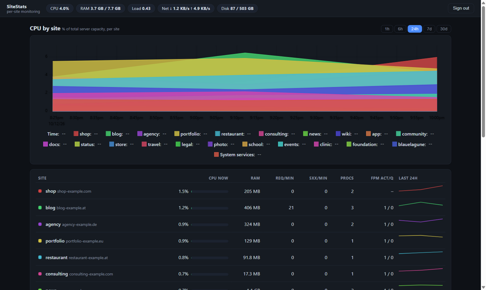

# SiteStats — Per-Site Monitoring Dashboard for CloudPanel

**SiteStats** is a lightweight, self-hosted monitoring dashboard for
[CloudPanel](https://www.cloudpanel.io/) servers that shows **CPU, memory, traffic,
PHP-FPM and disk usage for every website on your server** — not just server-wide totals.

When your monitoring (Beszel, Uptime Kuma, Netdata, …) alerts you that *the server* is
spiking, SiteStats answers the question that alert can't: **which website caused it,
what it was doing, and who was hitting it.**



## Why

Host-level monitors tell you *"the server CPU is at 80 %"* — but on a shared hosting box
with 20 websites, that's only half the story. SiteStats decomposes every spike **per
website** by exploiting CloudPanel's architecture: every site already runs as its own
Linux user with its own PHP-FPM pool and its own nginx access log. No agents, no changes
to your sites — just read what's already there.

## Features

- **Per-site CPU & memory** — exact process attribution by grouping `/proc` by site user,
  refreshed every 10 seconds, including top processes per site
- **Per-site HTTP traffic** — requests, bytes and 4xx/5xx errors per vhost, parsed from
  the nginx access logs (rotation-safe), with **top URLs and top client IPs** so you can
  spot bot floods and abusive clients
- **CPU spike attribution** — "CPU by site" chart: one glance shows which site ate the CPU
- **PHP-FPM pool status** — active/idle workers, listen queue and request rate per site
- **Per-site disk usage** — hourly `du` of every site's home directory
- **Alerts** — threshold rules (per-site CPU, 5xx rate, system CPU, …) with email and
  webhook notifications, evaluated per minute with cooldowns
- **Live view + history** — 1-minute resolution kept for 30 days (configurable),
  in-memory 10-second granularity for the last hour
- **Beszel-like simplicity** — single ~12 MB Go binary, ~40 MB RAM, SQLite storage,
  dark single-page UI with [uPlot](https://github.com/leeoniya/uPlot) charts
- **Zero site changes** — nothing is installed into your websites; the collector only
  reads `/proc`, nginx logs and PHP-FPM status endpoints
- **Demo mode** — `SiteStats demo` runs the full UI on synthetic data, no server
  attachment needed

## How it works

CloudPanel gives every website its own Linux user, PHP-FPM pool and nginx vhost.
SiteStats correlates all three:

1. **Site discovery** — parses `/etc/nginx/sites-enabled/*.conf` and
   `/etc/php/*/fpm/pool.d/*.conf`, matched against local user accounts
2. **Resource attribution** — scans `/proc` every 10 s and sums CPU/RAM per site user;
   everything not owned by a site (mysql, redis, nginx, root services) is bucketed as
   "System services"
3. **Traffic attribution** — tails each vhost's access log and aggregates requests,
   bytes, status codes, top URLs and top client IPs per minute
4. **Storage** — writes 1-minute rollups to SQLite (WAL) and serves them through a JSON
   API with automatic downsampling for long time ranges
5. **Serving** — a single static HTML/JS dashboard (uPlot charts) with password login,
   designed to sit behind a CloudPanel reverse-proxy vhost with Let's Encrypt TLS

## Requirements

- CloudPanel v2 on Debian (11/12/13) or Ubuntu — other "one Linux user per site" nginx +
  PHP-FPM setups work too, as long as each site has its own user and vhost
- Root access (to read every site's logs)
- Go 1.22+ to build

## Installation

### 1. Build

```bash
git clone https://github.com/REVENTOR-EU/SiteStats.git
cd SiteStats
GOOS=linux GOARCH=arm64 CGO_ENABLED=0 go build -trimpath -ldflags "-s -w" \
  -o sitestats ./cmd/SiteStats
# (amd64 servers: GOARCH=amd64)
```

### 2. Install on the server

```bash
scp sitestats deploy/sitestats.service deploy/config.example.yml root@your-server:/tmp/

ssh root@your-server
install -d /opt/sitestats /var/lib/sitestats
install -m 0755 /tmp/sitestats /opt/sitestats/sitestats
install -m 0644 /tmp/sitestats.service /etc/systemd/system/sitestats.service
systemctl daemon-reload && systemctl enable --now sitestats
```

The dashboard now listens on `127.0.0.1:8811`. On first visit you'll be asked to
**choose a dashboard password** right in the browser (it can be changed later via the
profile menu, top right). Alternatively set it via CLI:
`/opt/sitestats/sitestats -config /opt/sitestats/config.yml set-password`.

Verify site discovery with:

```bash
/opt/sitestats/sitestats -config /opt/sitestats/config.yml inspect
```

### 3. Expose it via CloudPanel

Create a **Reverse Proxy** site in CloudPanel for `stats.example.com` pointing to
`http://127.0.0.1:8811`, then issue a Let's Encrypt certificate — either in the CloudPanel
UI or via `clpctl`.

If your PHP-FPM pools don't already expose a status page, add `pm.status_path = /status`
to each pool and point SiteStats at it through nginx (see
[the wiki](https://github.com/REVENTOR-EU/SiteStats/wiki) for a ready-made
loopback-only nginx location block and `SiteStats write-nginx-map`).

## Configuration

Everything lives in one YAML file (defaults in
[`deploy/config.example.yml`](deploy/config.example.yml)):

```yaml
listen: 127.0.0.1:8811
data_dir: /var/lib/sitestats

collect:
  interval: 10s          # /proc scan
  fpm_interval: 30s
  disk_interval: 1h

retention:
  minute_days: 30        # per-minute samples
  disk_days: 90

alerts:
  rules:
    - name: site-high-cpu
      metric: site.cpu   # site.cpu | site.mem | site.req | site.err5 | system.cpu
      site: "*"          # one site username or all
      op: ">"
      value: 40          # % of total server CPU
      for: 5m
      cooldown: 1h
  email:
    enabled: false       # fill SMTP settings to enable
  webhook:
    enabled: false       # POSTs JSON: {rule, site, severity, message, ts}
```

## FAQ

**Which website is using my CPU on CloudPanel?**
That's exactly what SiteStats answers. Open the dashboard, look at the "CPU by site"
chart, and the site that caused the spike is the line that grew.

**Does it install anything into my websites?**
No. The collector only reads `/proc`, the nginx access logs and the PHP-FPM status
endpoints. Your sites are never modified.

**How is this different from Beszel / Netdata?**
Beszel monitors hosts and Docker containers; Netdata monitors everything with a heavy
agent. SiteStats sits in between: it's purpose-built to decompose a CloudPanel server
into its websites — a natural companion to Beszel rather than a replacement.

**Does it work without CloudPanel?**
Any nginx + PHP-FPM host where each site runs under its own Linux user works. Site
discovery expects the CloudPanel layout, but the config lets you point it at your vhost
and pool directories.

**Can I try it without a server?**
`SiteStats demo` serves the full UI with synthetic data for five fake sites.

## License

[GPL-3.0](LICENSE) — free open-source software
